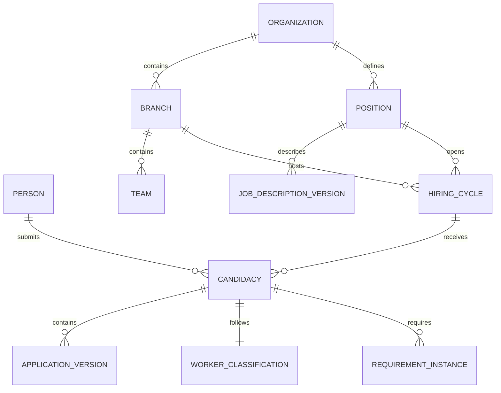
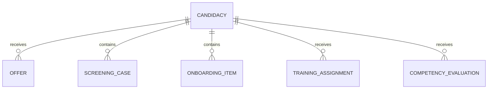
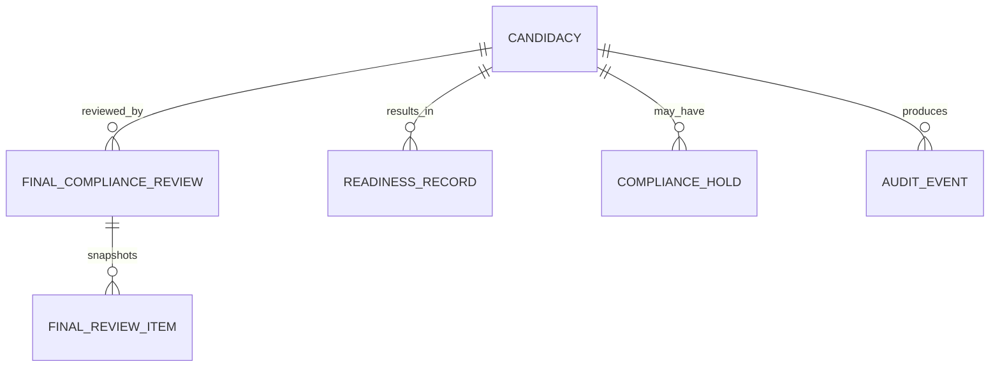

# Conceptual Data Model

## 1. Purpose

This document defines the conceptual relational data model for Release 1 of the PSA Workforce Hiring System. It is designed for PostgreSQL and a single TypeScript application, but it does not select a specific ORM.

The model supports:

- Reusable person identity with multiple candidacies over time.
- Separate W-2 and approved 1099 paths.
- Controlled workflow state transitions.
- Versioned forms, templates, requirements, evidence, and decisions.
- Restricted identity, financial, screening, and medical information.
- Task-level training and competency.
- Calculated and human-approved readiness.
- Role, scope, and field-level authorization.
- Append-only audit events and reliable external-provider work.

## 2. Modeling Conventions

### 2.1 Identifiers

- Use application-generated UUID or ULID primary keys.
- Do not expose sequential database identifiers in public URLs.
- Use separate short human-readable reference numbers where staff need them.
- External-provider identifiers are attributes, never primary keys.

### 2.2 Timestamps

Use timezone-aware UTC timestamps.

Common fields:

- `created_at`
- `created_by_user_id`
- `updated_at`
- `updated_by_user_id`
- `effective_from`
- `effective_to`
- `version`

Use business-effective dates separately from record-creation timestamps.

### 2.3 Optimistic Concurrency

Mutable aggregate roots contain an integer `version` that increments with every accepted command. Commands include the expected version and fail when stale.

### 2.4 Historical Integrity

- Do not overwrite signed, approved, adjudicated, or published records.
- Corrections create a new version, amendment, or superseding record.
- Use `supersedes_id` and `superseded_at` where a chronological chain is needed.
- Avoid hard deletion for business and compliance records.

### 2.5 Enumerations

Stable technical states may use database enums or checked text values. Configurable business categories must use reference tables rather than code enums.

### 2.6 Flexible Data

JSON may be used for:

- Versioned dynamic application answers.
- Provider payload references after sensitive-field filtering.
- Rule configuration.
- Immutable event metadata.

JSON must not replace core relational constraints, authorization fields, searchable statuses, or explicit foreign keys.

## 3. High-Level Relationships







## 4. Identity and Authentication Domain

### 4.1 `user_account`

Represents an authenticated account.

Key fields:

- `id`
- `email_normalized`
- `email_display`
- `account_type`: `CANDIDATE`, `STAFF`, `SERVICE`
- `status`: `INVITED`, `ACTIVE`, `LOCKED`, `DISABLED`, `CLOSED`
- `email_verified_at`
- `last_authenticated_at`
- `disabled_at`
- `disabled_reason_code`
- `auth_provider_subject`
- `version`
- Common timestamps

Constraints:

- Unique normalized email among applicable active accounts, subject to the selected identity-provider design.
- Service accounts may not be used for interactive login.
- Password hashes and multifactor secrets should remain in the selected identity system rather than business tables when possible.

Classification: Restricted Identity and Security.

### 4.2 `staff_profile`

Represents internal staff information linked to a user account.

Key fields:

- `id`
- `user_account_id`
- `employee_reference`
- `display_name`
- `job_title`
- `branch_id`
- `team_id`
- `status`
- `manager_staff_profile_id`
- Common timestamps

### 4.3 `role`

Implemented in M1.4 as `auth.role` (ADR-0005). Key fields:

- `id`
- `code` (stable, unique)
- `name`
- `description`
- `principal_type`: `CANDIDATE` or `STAFF`
- `status`: `ACTIVE` or `RETIRED`
- `is_system_role`
- `catalog_version`
- common timestamps

There is no admin, wildcard, superuser, or bypass field. Rows are written only by the reviewed catalog apply step (`pnpm db:catalog:apply`); the runtime role can only read them.

Initial role codes:

- `CANDIDATE`
- `RECRUITER`
- `HR_SPECIALIST`
- `CLASSIFICATION_REVIEWER`
- `COMPLIANCE_REVIEWER`
- `TRAINER_EVALUATOR`
- `PSA_MANAGER`
- `SYSTEM_ADMINISTRATOR`
- `AUDITOR_READ_ONLY`

Candidate entitlement is an account-to-candidacy ownership relationship (M2), not a staff assignment.

### 4.4 `permission`

Implemented in M1.4 as `auth.permission`. Key fields:

- `id`
- `code` (`<resource>.<action>`, 2–4 lowercase segments, no wildcard)
- `resource`
- `action`
- `operation`
- `max_sensitivity` (the classification upper bound)
- `permission_domain`: `BUSINESS`, `TECHNICAL`, or `CANDIDATE_SELF`
- `description`
- `status`
- Policy references and flags: `requires_scope`, `workflow_policy_code`, `recent_auth_policy` and `recent_auth_purpose`, `separation_policy_code`, `dual_control_hook`, `requires_reason`, `restricted_data`, `is_export`, `high_risk`
- `catalog_version`
- common timestamps

### 4.5 `role_permission`

Implemented in M1.4 as `auth.role_permission`. Join table:

- `role_id`
- `permission_id` (composite primary key with `role_id`)
- `condition`: a closed, versioned, declarative condition (`CANDIDATE_OWNERSHIP`, `DESIGNATION`, `PARTICIPANT`, or `HOLD_CATEGORY`); never an executable expression
- `status`
- `catalog_version`
- common timestamps

### 4.6 `user_role_assignment`

Implemented in M1.4 as `auth.user_role_assignment`. Key fields:

- `id`
- `user_account_id`
- `role_id`, plus `principal_type` (always `STAFF`) in a composite foreign key to `role(id, principal_type)`
- `scope_type`: `ASSIGNED_RECORDS`, `TEAM`, `BRANCH`, `ORGANIZATION`, `AUDIT_ASSIGNMENT`
- `scope_reference_id` (required; resolved through the scope-resolver port until the M2 entities exist)
- `effective_from` (inclusive)
- `effective_to` (exclusive, nullable)
- `status`: `PROPOSED`, `ACTIVE`, `REJECTED`, `REVOKED`, `SUPERSEDED`
- `reason_code`
- `reason_reference` (optional opaque reference; no free text)
- `created_by_user_id`
- `approved_by_user_id`, `approved_at`
- `revoked_at`, `revoked_by_user_id`, `revocation_reason_code`
- `replaces_assignment_id`, `superseded_by_assignment_id`
- `version`
- common timestamps

Constraints:

- Active privileged assignments require an approver, who is neither the subject nor the requester.
- `effective_to` is after `effective_from`.
- Equivalent pending or active assignments may not overlap.
- Role, scope, and dates are never rewritten. A change creates a successor that supersedes the old row, and revoked rows never reactivate.
- A role removal takes effect without requiring a new login. Approval, revocation, and supersession also end the subject's sessions.
- The runtime role may insert rows and update lifecycle columns only. Nothing is deleted.

### 4.6a `authorization_subject`

Implemented in M1.4 as `auth.authorization_subject`: a one-to-one, monotonic `authorization_version` and `version_changed_at` per account. They are incremented in the same transaction as every assignment change affecting the subject.

### 4.7 `audit_assignment`

Limits an auditor to an approved audit scope.

Key fields:

- `id`
- `auditor_user_id`
- `purpose`
- `scope_definition_json`
- `starts_at`
- `ends_at`
- `approved_by_user_id`
- `status`

## 5. Organization and Position Domain

Implemented in M2.1 (`docs/tasks/M2.1_ORGANIZATION_BRANCH_POSITION_HIRING_CYCLE.md`) by the `organization` module, in the `app` schema (migration `0005_organization_hiring_cycle`).

Conventions for every table in this section:

- Primary keys are database-generated UUIDs (`pg_catalog.gen_random_uuid()`, ADR-0002). Sequential identifiers are never exposed.
- Codes are normalized on input (trimmed and upper-cased) and stored normalized, so uniqueness is case-insensitive. A code matches `^[A-Z0-9][A-Z0-9_-]{1,31}$`.
- Names, titles, and labels are bounded plain text. They are validated, not silently rewritten.
- Timezones are IANA zone names validated by the application.
- Mutable aggregates carry an integer `version` (≥ 1) used for optimistic concurrency, `created_at`, `updated_at`, `created_by_account_id`, and `updated_by_account_id`.
- Foreign keys never cascade. Rows are never deleted: `DELETE` and `TRUNCATE` are refused by trigger and by runtime-role privileges.
- Parent references (`organization_id`, `branch_id`) are immutable. Reparenting is not an ordinary edit (a trigger refuses it).
- Codes are immutable once the record has been activated (or, for a hiring cycle, published).
- Every change is a named command that appends its audit event in the same transaction (M1.6, ADR-0012).

### 5.0 Position versus public opening

- A `position` is reusable business configuration that describes a role the agency may fill. It is never shown to the public directly.
- A `job_description_version` is immutable published wording for a position.
- A `hiring_cycle` is one specific opening and application window for a position at one branch and optional team. Several cycles may exist for one position.
- The public `/positions` list and `/positions/[positionId]` detail display a safe projection of **hiring cycles**. The route parameter is the cycle's nonsequential `public_reference`, even though the UI calls it a position.
- No competing posting, requisition, vacancy, or campaign concept exists.

### 5.1 `organization`

Release 1 may use a single organization row but retains an explicit entity for future separation. Nothing assumes a singleton or treats the first row as authoritative.

Key fields:

- `id`
- `code` (unique)
- `legal_name`, `display_name`
- `timezone`
- `status`: `DRAFT`, `ACTIVE`, `INACTIVE`, `ARCHIVED`
- `activated_at`, `inactivated_at`
- `version`, common timestamps and actor references

Rules:

- Only an `ACTIVE` organization may contain a publicly open hiring cycle. Inactivation stops new and public openings and keeps history.
- `ARCHIVED` is reserved. M2.1 has no archive command.
- The first organization is provisioned through the nonproduction harness actor (local/test only). A production provisioning procedure is an open decision (§28).

### 5.2 `branch`

Key fields:

- `id`, `organization_id`
- `code` (unique within organization)
- `name`
- `public_location_label` (public)
- `timezone` (explicitly entered; the form pre-fills the organization timezone)
- `status`: `DRAFT`, `ACTIVE`, `INACTIVE`, `ARCHIVED`
- `version`, common timestamps

Activation requires an `ACTIVE` organization.

### 5.3 `team`

Key fields:

- `id`, `organization_id`, `branch_id`
- `code` (unique within branch)
- `name`
- `status`: `DRAFT`, `ACTIVE`, `INACTIVE`, `ARCHIVED`
- `version`, common timestamps

A composite foreign key `(organization_id, branch_id)` → `branch(organization_id, id)` guarantees the team's organization is its branch's organization. Activation requires an `ACTIVE` branch and organization.

### 5.4 `position`

Reusable configuration describing a role the agency may fill.

Key fields:

- `id`, `organization_id`
- `code` (unique within organization)
- `internal_title`, `public_title`
- `worker_paths_allowed`: `W2_ONLY`, `CONTRACTOR_ELIGIBLE_ONLY`, `W2_AND_CONTRACTOR_ELIGIBLE`
- `status`: `DRAFT`, `ACTIVE`, `INACTIVE`, `RETIRED`
- `activated_at`, `retired_at`
- `version`, common timestamps

Rules:

- "Contractor eligible" means only that the position may support a proposed 1099 path. It classifies nobody and guarantees no contractor treatment.
- No configuration action approves an individual's classification. W-2 remains the default proposed path in later candidacy and classification work.
- Changing `worker_paths_allowed` never changes a published hiring-cycle snapshot.
- Only `ACTIVE` positions accept new hiring cycles. `RETIRED` is terminal; a new position is required when the meaning changes materially.
- Deferred until their reference tables exist (no placeholder or dangling foreign keys): employment-type options, default requirement-matrix, training-matrix, and competency-profile references.
- The current description is the position's single `PUBLISHED` `job_description_version`; there is no pointer column.

### 5.5 `job_description_version`

Key fields:

- `id`, `organization_id`, `position_id`
- `version_number` (unique per position, monotonic; allocated under the position row lock)
- `public_title`, `summary`, `body`
- `content_format`: `PLAIN_TEXT_V1` (bounded plain text; no HTML, links, embeds, or templates)
- `status`: `DRAFT`, `PUBLISHED`, `SUPERSEDED`, `RETIRED`
- `published_at`, `published_by_account_id`, `superseded_at`
- `version` (draft editing only), common timestamps

Rules:

- At most one `DRAFT` and at most one `PUBLISHED` version per position (partial unique indexes).
- Published content is immutable. A trigger allows only the `PUBLISHED → SUPERSEDED` status change; content edits on any non-draft version are refused.
- Editing published wording creates a new draft version.
- Publishing a draft supersedes the prior published version in the same transaction. Published and superseded versions are never deleted.
- Content is rejected if it contains control or bidirectional-override characters, markup-like tags, `javascript:`/`data:` schemes, or template syntax. It is rendered only as escaped text.
- `RETIRED` is reserved; M2.1 has no retire-description command.

### 5.6 `hiring_cycle`

One opening and application window for a reusable position at one branch and optional team.

Key fields:

- `id` (internal)
- `public_reference`: 12-character random Crockford base32, unique; used in public URLs
- `organization_id`, `position_id`, `branch_id`, `team_id` (nullable)
- `code` (unique within organization)
- `internal_label`, `public_label` (nullable)
- `status`: `DRAFT`, `PUBLISHED`, `OPEN`, `CLOSED`, `CANCELLED`, `ARCHIVED`
- `opens_at` (inclusive)
- `closes_at` (exclusive; null only when `open_ended` is explicitly true)
- `open_ended`
- Snapshot, frozen at publication:
  - `job_description_version_id`
  - `worker_paths_snapshot`
  - `public_title_snapshot`
  - `location_label_snapshot`
  - `display_timezone`
- Lifecycle:
  - `published_at`/`published_by_account_id`
  - `opened_at`/`opened_by_account_id`
  - `closed_at`/`closed_by_account_id`
  - `cancelled_at`/`cancelled_by_account_id`
  - `archived_at`/`archived_by_account_id`
  - `end_reason_code`
- `version`, common timestamps

Relational integrity (composite foreign keys):

- `(organization_id, position_id)` → `position(organization_id, id)`
- `(organization_id, branch_id)` → `branch(organization_id, id)`
- `(branch_id, team_id)` → `team(branch_id, id)`; a null team is allowed
- `(position_id, job_description_version_id)` → `job_description_version(position_id, id)`

Lifecycle (named commands only):

```text
create_hiring_cycle:   none -> DRAFT
update_hiring_cycle:   DRAFT -> DRAFT
publish_hiring_cycle:  DRAFT -> PUBLISHED
open_hiring_cycle:     PUBLISHED -> OPEN
close_hiring_cycle:    OPEN/PUBLISHED -> CLOSED
cancel_hiring_cycle:   DRAFT/PUBLISHED/OPEN -> CANCELLED
archive_hiring_cycle:  CLOSED/CANCELLED -> ARCHIVED
```

- **Publish** requires:
  - an `ACTIVE` organization, branch, optional team, and position;
  - the position's `PUBLISHED` description;
  - a coherent window;
  - authorization, the expected version, and a reason code.
- **Open** requires the same, and `opens_at ≤ now < closes_at`.
- A trigger refuses changes to references, snapshot, window, or code after publication. It also refuses any return from `CLOSED`/`CANCELLED`/`ARCHIVED`.
- Reopening requires a new cycle.

Effective public availability is computed at request time from trusted stored state and the server clock. No background job is involved.

| State                                                                         | Public result                 |
| ----------------------------------------------------------------------------- | ----------------------------- |
| `OPEN`, every parent `ACTIVE`, and `opens_at ≤ now < closes_at`               | Listed and accepting          |
| `OPEN` at or after `closes_at`, or with an inactive parent                    | Generic "no longer accepting" |
| `CLOSED` after having been opened                                             | Generic "no longer accepting" |
| `DRAFT`, `PUBLISHED`, `CANCELLED`, `ARCHIVED`, never-opened `CLOSED`, unknown | Indistinguishable not-found   |

Upcoming (published but not yet open) display is not approved and is not implemented.

Later edits to the organization, branch, team, position, or a newer description never alter a published cycle. The public detail renders only the snapshot and the immutable description version it references.

### 5.7 Scope resolution

The M1 `ScopeResourceResolver` port has a real adapter (`organization` module):

- **`ORGANIZATION`, `BRANCH`, `TEAM`** scopes resolve from these tables. They are `ACTIVE` only when the entity and every ancestor are `ACTIVE`.
- **Business records** (position, description version, hiring cycle, and the hierarchy rows themselves) resolve to their organization, branch, and team placement.
- **`ASSIGNED_RECORDS` and `AUDIT_ASSIGNMENT`** still resolve as unavailable: their tables do not exist yet. No row is fabricated for an unresolved reference.

## 6. Person and Candidacy Domain

M2.2 implements `person`, `candidacy`, `candidacy_stage_history`, `duplicate_candidate_match`, `person_merge_record`, and `candidate_command_receipt` (migration `0006_person_candidacy`, `candidates` module). `address` and `person_sensitive_identity` are not created yet. Rows are never hard-deleted: the runtime role has no `DELETE` or `TRUNCATE` on any of these tables, and triggers (error class `CN`) refuse deletes as well.

### 6.1 `person`

Canonical identity, independent of any account, candidacy, or application.

Key fields:

- `id`: database-generated UUID; persons have no public or route reference.
- `legal_first_name`, `legal_middle_name` (nullable), `legal_last_name`, `preferred_name` (nullable): at most 100 characters each.
- `email_display`, `email_normalized`.
- `phone_display` (nullable), `phone_e164` (nullable; set only for a validly formed number).
- `normalization_version`: currently `NORM-1`.
- `candidate_account_id` (nullable; FK to the auth user): the one candidate-account owner.
- `status`: `ACTIVE`, `MERGED`, `ARCHIVED`.
- `merged_into_person_id`, `merged_at`: set exactly when the status is `MERGED`.
- `version`, actor columns, common timestamps.

Normalization `NORM-1`, applied on the server:

- **Names:** Unicode NFC and whitespace collapse. Letters and marks of any script, spaces, apostrophes, hyphens, and periods are accepted. Controls, zero-width characters, bidi overrides, digits, symbols, and markup are refused. Names are never a comparison key.
- **Email:** the identity module's login-email normalization. A candidate's email is always their account's verified login email, read on the server.
- **Phone:** a display value. An E.164 comparison value is derived for NANP numbers and for numbers already in `+<digits>` form.

Ownership:

- **One to one.** A partial unique index on `candidate_account_id`, and a trigger requires the owner to be an `ACTIVE`, verified `CANDIDATE` account.
- **Linking is server-derived only.** Creating a candidate's own person links it. A link is never replaced or removed, except when a merge transfers it.
- **Staff-entered prospects are unowned.** The prospect invitation and claim path is deferred.
- **A merged person is frozen,** and email and creation facts are immutable.

Indexes: exact B-tree indexes on `email_normalized` and `phone_e164` only. There is no fuzzy, trigram, or full-text index.

Date of birth, address, and tax identifiers are not collected in M2.2.

Classification: Confidential Personnel.

### 6.2 `address`

Not implemented (no approved M2.2 use).

Key fields:

- `id`
- Encrypted or protected address fields
- `address_type`
- `valid_from`
- `valid_to`

### 6.3 `person_sensitive_identity`

Not implemented. It stores highly restricted identity values separately.

Key fields:

- `person_id`
- `tax_identifier_ciphertext`
- `tax_identifier_last_four`
- `encryption_key_version`
- `updated_at`
- `updated_by_user_id`

Access must be rare, recently authenticated, and audited.

### 6.4 `candidacy`

One person's candidacy for one M2.1 hiring cycle.

Key fields:

- `id`: internal UUID, never shown in a URL.
- `public_id`: 12 random lowercase Crockford characters, unique; the staff route identifier.
- `candidate_reference`: `C-` plus 8 random Crockford characters, unique; a human support reference.
- `person_id`.
- `hiring_cycle_id`, `organization_id`, `position_id`, `branch_id`, `team_id` (nullable).
- `source_code`: `CANDIDATE_SELF_SERVICE` or `STAFF_ENTERED`.
- `current_stage`: `PROSPECT`, `APPLICATION_INCOMPLETE`, or `APPLICATION_SUBMITTED` (M2.6).
- `status`: `ACTIVE`, `TERMINAL`, `ARCHIVED`.
- `candidate_visible_status`:
  - `NOT_STARTED` for an active `PROSPECT`;
  - `APPLICATION_STARTED` for an active `APPLICATION_INCOMPLETE`;
  - `CLOSED` otherwise.
- `owner_account_id` (nullable): the staff member following up.
- `proposed_worker_path`: `UNDECIDED` (default), `W2`, `CONTRACTOR`. This is never a classification decision.
- `started_at`: set when the application stage is entered, then immutable.
- `closed_at`, `closure_reason_code`: set together when a prospect is closed.
- `version`, actor columns, common timestamps.

Integrity:

- **Opening coherence.** A composite FK `(hiring_cycle_id, organization_id, position_id, branch_id)` references the new `hiring_cycle_candidacy_key` unique key. A trigger requires `team_id` to equal the cycle's team. The opening references never change after insert.
- **Current uniqueness.** A partial unique index `candidacy_current_unique` covers `(person_id, hiring_cycle_id)` where the status is `ACTIVE`. A concurrent second start maps to the existing candidacy.
- **Reparenting.** `person_id` may change only to the survivor recorded in a `person_merge_record`.
- **Stage and status moves.** There is no backward stage move and no reopening.
- **Creation-time checks.** The cycle must be effectively accepting at creation: `OPEN`, every parent `ACTIVE`, and inside its window. This is checked under a share lock.
- **No downstream placeholders.** No application, template, draft, or answer row is created. Application versions remain M2.4 scope (§7.3).

Stage commands (`candidacy_stage_history.command_code`):

```text
create_prospect:                  none -> PROSPECT (ACTIVE)            staff
start_application:                none -> APPLICATION_INCOMPLETE       candidate (own)
start_application_from_prospect:  PROSPECT -> APPLICATION_INCOMPLETE   staff
close_prospect:                   PROSPECT ACTIVE -> TERMINAL          staff, reason
```

Owner assignment does not change the stage.

### 6.5 `candidacy_stage_history`

An append-only transition record. The runtime role has no `UPDATE`, `DELETE`, or `TRUNCATE`, and triggers also refuse these.

Key fields:

- `id`, `candidacy_id`
- `from_stage`, `to_stage`, `from_status`, `to_status`
- `command_code`
- `actor_account_id` or `system_actor`
- `reason_code`
- `version_before`, `version_after`
- `correlation_id`, `occurred_at`

There is no free-text comment and no message-template reference in M2.2.

### 6.6 `duplicate_candidate_match`

An advisory duplicate case. It never blocks, links, or merges anything by itself.

Key fields:

- `id`, `public_id` (12 characters; the review route identifier)
- `organization_id`
- `person_a_id`, `person_b_id`: canonical ordering `a < b`, never the same person.
- `ruleset_version`: `DUP-1`.
- `signal_codes`: a subset of `EXACT_EMAIL`, `EXACT_PHONE`. No raw values are stored.
- `confidence_tier`: `HIGH` when the email matches, otherwise `MEDIUM`.
- `status`: `PENDING`, `CONFIRMED_DUPLICATE`, `NOT_DUPLICATE`, `MERGED`.
- `reviewed_by_account_id`, `reviewed_at`, `reason_code`, `merge_record_id`, `version`.

Rules:

- Comparison runs only against `ACTIVE` persons with a candidacy in the same organization.
- The partial unique index `duplicate_candidate_match_open_unique` allows one open case (`PENDING` or `CONFIRMED_DUPLICATE`) per pair and ruleset.
- The evidence columns are immutable.
- The only status moves are `PENDING → CONFIRMED_DUPLICATE`, `PENDING → NOT_DUPLICATE`, and `CONFIRMED_DUPLICATE → MERGED`.

### 6.7 `person_merge_record`

Records an authorized merge without erasing either identity. Append-only.

Key fields:

- `id`, `surviving_person_id`
- `merged_person_id`: unique, so a person is merged at most once.
- `match_id`
- `field_resolution_codes`: for example `SURVIVOR_ACCOUNT_OWNED` or `SURVIVOR_OLDEST`, `SURVIVOR_IDENTITY_KEPT`, `CANDIDACIES_REPARENTED`, `ACCOUNT_LINK_TRANSFERRED`.
- `reason_code`, `executed_by_account_id`, `occurred_at`

Merge rules:

- **Survivor.** The account-owned person survives; otherwise the older record (ties are broken by ID).
- **Effects:**
  - the merge record is written first;
  - the merged person's candidacies are reparented;
  - any account link moves to the survivor;
  - the merged person becomes `MERGED` with `merged_into_person_id`;
  - the case becomes `MERGED`.
- **Preservation.** Old candidacy public IDs and references keep resolving.
- **Blocking.** A merge is refused atomically, with a durable `person.merge_blocked` denial event, when:
  - the case is not confirmed;
  - either person is not `ACTIVE`;
  - two different candidate accounts are involved;
  - both persons hold an `ACTIVE` candidacy for the same hiring cycle.

### 6.8 `candidate_command_receipt`

Idempotency receipts for M2.2 commands. Append-only.

Key fields:

- `actor_account_id`, `command_key`: unique together.
- `command_name`
- `request_fingerprint`: SHA-256 hex of the canonical request; it never contains PII.
- `target_id`, `result_version`, `outcome_code`, `created_at`

The same key with the same fingerprint replays the original outcome. The same key with a different request is refused (`COMMAND_KEY_CONFLICT`).

### 6.9 Deferred

These remain later work and are not implemented:

- prospect invitation and claim;
- an outbox for notifications;
- a retention or purge job;
- date of birth and address;
- staff owner assignment to anyone other than oneself.

## 7. Application and Interview Domain

### 7.1 `application_template`

M2.4 implements `application_template`, `application_template_version`, `application_version`, and `application_draft_section` (migration `0007_application_draft`, `applications` module). Nothing is ever hard-deleted, and no foreign key cascades.

Key fields:

- `id`
- `code`: unique. M2.4 seeds one template, `CANDIDATE_APPLICATION`.
- `name`
- `created_at`

Append-only (error class `CN`), and the runtime role has `SELECT` only.

### 7.2 `application_template_version`

Key fields:

- `id`
- `application_template_id`
- `version_number`: unique per template.
- `schema_json`: sections and fields. It is parsed strictly before use, so a malformed version is refused rather than shown.
- `published_at`
- `effective_from`
- `effective_to`
- `created_at`

Rules:

- Append-only, even for the migration owner. A change ships as a new version.
- A new draft uses the newest version effective at that moment. An existing draft stays on the version it started with.
- Version 1 has four neutral sections: availability, experience, education, and references. Its wording is a draft awaiting business review. It deliberately has no eligibility or disclosure questions, date of birth, or tax identifier.
- There is no template editor yet, and one template applies to every position and worker path. Configuring required questions by worker path and position (PRD-APP-002) remains open.

### 7.3 `application_version`

Key fields:

- `id`
- `candidacy_id`
- `template_version_id`
- `version_number`
- `status`: `DRAFT`, `SUBMITTED`, `RETURNED`, or `SUPERSEDED`.
- `supersedes_id`: the returned version this one corrects (M2.7).
- `created_by_account_id`
- `created_at`

Rules:

- A partial unique index allows one `DRAFT` per candidacy.
- A draft begins only through `begin_application_draft`. Reading a page never creates one.
- The candidacy, template version, version number, and creation facts never change (trigger).
- A version becomes `SUBMITTED` only with its frozen `application_submission`, and it never goes back (trigger).
- The lifecycle is `DRAFT`, `SUBMITTED` (with its frozen record), `RETURNED` (with its return), then `SUPERSEDED` once a correction is submitted (trigger).
- A correction is a new version on the same template, pre-filled from the frozen answers. Every submitted version and its frozen record stay.

`application_draft_section` holds one section's answers:

- `id`
- `application_version_id`
- `section_code`: unique per application version.
- `answers`: a JSON object, size bounded. Field names and values are validated against the pinned template.
- `completion_status`: `IN_PROGRESS` or `COMPLETE`, set by the server. Not started means no row.
- `version`: optimistic. Each write adds exactly one (trigger); a save names the version it read, or 0 for the first save.
- `saved_by_account_id`, `saved_by_kind` (`CANDIDATE` or `STAFF_ASSIST`), `assist_reason_code` (required only for an assist), `saved_at`
- `created_at`

Rules:

- Draft answers are Confidential Personnel. They hold no restricted identity, financial, screening, or medical field.
- Answers are overwritten in place while in draft; earlier draft values aren't kept. Audit records each save's section, status, and version, and never an answer.
- `application.assist` has no role grant, so no staff member can write a draft today.

M2.6 adds migration `0010_application_submission`, with three more tables.

`application_certification_version` holds each certification statement:

- `id`, `version_number`, `statement`, `effective_from`, `created_at`
- `review_status`: `DRAFT_UNREVIEWED` or `APPROVED`. **Version 1 is `DRAFT_UNREVIEWED`: its wording needs counsel's review before real use.** Approved text ships as a new version, and past submissions keep the version they accepted.
- Append-only; the runtime role has `SELECT` only.

`application_submission` is the frozen record of one submission:

- `id`, `application_version_id` (unique), `candidacy_id`, `template_version_id`, `certification_version_id`
- `answers`: every section's answers at submission.
- `content_hash`: SHA-256 of the answers, attachment versions, and certification version the candidate reviewed.
- `certified_name`: the typed name.
- `receipt_number`: `R-` plus eight random characters; unique, and not a credential.
- `submitted_by_account_id`, `submitted_at`
- Append-only, even for the migration owner.

`application_submission_attachment` lists exactly which clean document versions were frozen (a trigger refuses any other).

Rules:

- A submission re-checks everything in one transaction: ownership, stage, the hiring cycle still accepting, every section against the pinned template, and that nothing changed since the review page was read.
- No attachment is required (owner decision, 2026-11-03). Files without a clean version are left out, and the review page says so.
- A first submission is refused once the hiring cycle stops accepting (owner decision, 2026-11-04), and the draft is kept. A correction staff asked for can still be submitted.

M2.7 adds migration `0011_application_return` and `application_return`, one per returned version:

- `id`, `application_version_id` (unique), `candidacy_id`
- `reason_code`: `INCOMPLETE_INFORMATION`, `INCORRECT_INFORMATION`, `UNCLEAR_ANSWER`, `ATTACHMENT_PROBLEM`, or `OTHER`.
- `instructions`: up to 1000 characters, **candidate-visible**. Stored here and shown as plain text. It never reaches audit or email, and it is separate from internal notes.
- `reopened`: section codes, each with the fields staff flagged. A flag guides the candidate; the whole section is editable (owner decision, 2026-11-04).
- `attachments_reopened`
- `returned_by_account_id`, `returned_at`
- Append-only, even for the migration owner.

### 7.4 `prescreen_review`

Key fields:

- `id`
- `candidacy_id`
- `application_version_id`
- `checklist_version_id`
- `reviewer_user_id`
- `outcome`
- `responses_json`
- `internal_notes`
- `completed_at`
- `version`

### 7.5 `interview`

Key fields:

- `id`
- `candidacy_id`
- `interview_type_code`
- `status`
- `scheduled_start_at`
- `scheduled_end_at`
- `timezone`
- `location_or_meeting_reference`
- `candidate_visible_instructions`
- `cancellation_reason_code`
- Common timestamps

### 7.6 `interview_participant`

- `interview_id`
- `user_account_id`
- `participant_role`
- `attendance_status`

### 7.7 `scorecard_template_version`

Key fields:

- `id`
- `code`
- `version_number`
- `schema_json`
- `published_at`
- `effective_from`
- `effective_to`

### 7.8 `interview_scorecard`

Key fields:

- `id`
- `interview_id`
- `template_version_id`
- `interviewer_user_id`
- `responses_json`
- `total_score`
- `recommendation_code`
- `internal_notes`
- `submitted_at`
- `version`

One interviewer has at most one current submitted scorecard per interview and template version.

### 7.9 `selection_decision`

Key fields:

- `id`
- `candidacy_id`
- `decision`: `SELECTED`, `NOT_SELECTED`, `ADDITIONAL_INTERVIEW`, `ON_HOLD`
- `reason_code`
- `internal_rationale`
- `candidate_message_template_version_id`
- `decided_by_user_id`
- `decided_at`
- `supersedes_id`

## 8. Worker Classification Domain

### 8.1 `worker_classification_review`

Key fields:

- `id`
- `candidacy_id`
- `proposed_path`: `W2`, `CONTRACTOR`
- `status`
- `questionnaire_version_id`
- `responses_json`
- `proposed_by_user_id`
- `proposed_at`
- `assigned_reviewer_user_id`
- `decision`: `W2_APPROVED`, `CONTRACTOR_APPROVED`, `CONTRACTOR_REJECTED`, `MORE_INFORMATION_REQUIRED`
- `restricted_rationale`
- `decided_by_user_id`
- `decided_at`
- `supersedes_id`
- `version`

Constraints:

- Proposer and final reviewer cannot be the same user when separation is required.
- A contractor agreement requires a current `CONTRACTOR_APPROVED` decision.
- One review is current; prior reviews remain immutable.

### 8.2 `classification_evidence`

Links supporting evidence without storing it in the review row.

- `classification_review_id`
- `document_id`
- `evidence_type_code`
- `added_by_user_id`
- `added_at`

## 9. Offer and Agreement Domain

### 9.1 `document_template`

Used for offers, agreements, forms, acknowledgments, and notices.

Key fields:

- `id`
- `code`
- `document_type`
- `name`
- `status`

### 9.2 `document_template_version`

Key fields:

- `id`
- `document_template_id`
- `version_number`
- `content_source`
- `variable_schema_json`
- `published_at`
- `published_by_user_id`
- `effective_from`
- `effective_to`

### 9.3 `offer`

Aggregate root.

Key fields:

- `id`
- `candidacy_id`
- `offer_type`: `W2_CONDITIONAL_OFFER`, `CONTRACTOR_AGREEMENT`
- `status`
- `current_offer_version_id`
- `version`
- Common timestamps

### 9.4 `offer_version`

Key fields:

- `id`
- `offer_id`
- `version_number`
- `template_version_id`
- `classification_review_id`
- `position_id`
- `compensation_terms_json`
- `work_terms_json`
- `generated_document_id`
- `status`
- `approved_by_user_id`
- `approved_at`
- `issued_at`
- `expires_at`
- `withdrawn_at`
- `supersedes_id`

Rules:

- Issued versions are immutable.
- Only the latest eligible issued version may be accepted.
- Contractor versions must link to an approved classification review.

### 9.5 `signature_record`

Key fields:

- `id`
- `document_version_id`
- `signer_person_id`
- `signer_user_account_id`
- `signature_type`
- `provider_reference`
- `signed_at`
- `evidence_hash`
- `ip_address_protected`
- `user_agent_protected`
- `status`

## 10. Configurable Requirements Domain

### 10.1 `requirement_definition`

Defines a reusable requirement category.

Examples:

- Criminal record check.
- Nurse aide/home health aide abuse registry.
- Caregiver misconduct registry.
- Drug screen.
- TB risk assessment.
- W-4.
- I-9.
- Confidentiality acknowledgment.
- Abuse-reporting training.
- Task competency.

Key fields:

- `id`
- `code`
- `name`
- `domain`: `SCREENING`, `ONBOARDING`, `TRAINING`, `COMPETENCY`, `OTHER`
- `data_classification`
- `is_waivable`
- `supports_expiration`
- `status`

### 10.2 `requirement_matrix`

Key fields:

- `id`
- `code`
- `name`
- `status`

### 10.3 `requirement_matrix_version`

Key fields:

- `id`
- `requirement_matrix_id`
- `version_number`
- `effective_from`
- `effective_to`
- `published_by_user_id`
- `published_at`
- `status`

### 10.4 `requirement_rule`

Key fields:

- `id`
- `matrix_version_id`
- `requirement_definition_id`
- `applies_when_json`
- `required`
- `due_offset_days`
- `validity_period_days`
- `blocking_stage`
- `waiver_permission_code`
- `display_order`

Conditions may include position, W-2/1099 path, requested capability, and future branch or jurisdiction. Rules must use a validated condition format, not executable user-entered code.

### 10.5 `requirement_set`

Snapshot generated for a candidacy.

Key fields:

- `id`
- `candidacy_id`
- `matrix_version_id`
- `classification_review_id`
- `position_id`
- `generated_at`
- `generated_by_user_id`
- `supersedes_id`
- `status`

### 10.6 `requirement_instance`

Represents one applicable requirement.

Key fields:

- `id`
- `requirement_set_id`
- `requirement_definition_id`
- `domain_record_type`
- `domain_record_id`
- `status`
- `required`
- `due_at`
- `satisfied_at`
- `expires_at`
- `blocking_stage`
- `waived_by_user_id`
- `waiver_reason`
- `superseded_at`
- `version`

Constraints:

- Waiver fields are permitted only when the definition and actor permission allow it.
- A current required instance must link to its domain evidence or explicitly show why no evidence exists.

## 11. Screening and Restricted Health Domain

Screening and medical tables should be separated logically and, where practical, by database schema or access boundary.

### 11.1 `screening_case`

Aggregate root for one screening requirement.

Key fields:

- `id`
- `candidacy_id`
- `requirement_instance_id`
- `screening_type_code`
- `status`
- `assigned_reviewer_user_id`
- `candidate_visible_status_code`
- `current_order_id`
- `current_result_id`
- `current_disposition_id`
- `version`
- Common timestamps

### 11.2 `screening_authorization`

Key fields:

- `id`
- `screening_case_id`
- `authorization_type`
- `template_version_id`
- `signed_document_version_id`
- `authorized_at`
- `expires_at`
- `status`

### 11.3 `screening_order`

Key fields:

- `id`
- `screening_case_id`
- `provider_code`
- `provider_reference`
- `idempotency_key`
- `ordered_by_user_id`
- `ordered_at`
- `status`
- `appointment_at`
- `canceled_at`
- `version`

Unique constraint on provider and idempotency key.

### 11.4 `screening_result`

Restricted record.

Key fields:

- `id`
- `screening_case_id`
- `screening_order_id`
- `result_version`
- `provider_status_code`
- `received_at`
- `effective_date`
- `expires_at`
- `restricted_summary_code`
- `raw_payload_storage_reference`
- `report_document_id`
- `content_hash`
- `supersedes_id`

Avoid copying full provider payloads into general application tables or logs.

### 11.5 `screening_disposition`

Key fields:

- `id`
- `screening_case_id`
- `screening_result_id`
- `decision`: `CLEARED`, `ADDITIONAL_INFORMATION`, `PRE_ADVERSE`, `FINAL_ADVERSE`, `RETEST`
- `restricted_reason_code`
- `restricted_rationale`
- `decided_by_user_id`
- `decided_at`
- `second_approver_user_id`
- `second_approved_at`
- `supersedes_id`

### 11.6 `adverse_action_case`

Key fields:

- `id`
- `screening_case_id`
- `status`
- `pre_adverse_notice_document_id`
- `pre_adverse_sent_at`
- `response_due_at`
- `candidate_response_received_at`
- `dispute_opened_at`
- `dispute_resolved_at`
- `final_decision`
- `final_notice_document_id`
- `final_notice_sent_at`
- `closed_at`
- `assigned_reviewer_user_id`
- `version`

### 11.7 `tb_clearance_record`

Restricted medical record separated from general screening fields.

Key fields:

- `id`
- `screening_case_id`
- `assessment_date`
- `assessment_provider_type`
- `risk_result_code`
- `follow_up_required`
- `follow_up_type_code`
- `follow_up_result_code`
- `medical_clearance_status`
- `cleared_at`
- `expires_at`
- `supporting_document_id`
- `reviewed_by_user_id`
- `reviewed_at`

Store only information necessary for the employment clearance workflow.

## 12. Document Domain

M2.5 implements `document` and `document_version` for application attachments (migration `0009_application_attachments`, `documents` module). `document_link` and `document_access_event` aren't created: a document names its candidacy directly, and the append-only audit history records access. Later document types may add them.

### 12.1 `document`

Logical document identity.

Key fields:

- `id`
- `public_id`: used in routes. It grants nothing.
- `candidacy_id`: ownership comes from candidacy, person, and account, so a person merge keeps it correct.
- `category_code`: `RESUME` or `CREDENTIAL` in M2.5.
- `data_classification`: `CONFIDENTIAL_PERSONNEL`.
- `retention_class_code`: `APPLICATION_ATTACHMENT_UNSET` until the retention schedule is approved.
- `current_version_id`: moves only to this document's clean version.
- `status`: `ACTIVE` or `REMOVED`. Removing hides the document; the record and its stored bytes stay.
- `version`: optimistic; each change adds one (trigger).
- `created_by_account_id`, `created_at`, `updated_at`

### 12.2 `document_version`

Key fields:

- `id`
- `document_id`
- `version_number`
- `storage_provider_code`
- `storage_object_key`: a generated UUID, never a file name, and never returned to a client.
- `display_name`: normalized, with paths and unsafe characters removed.
- `media_type`: from the file's signature, not the client.
- `size_bytes`
- `content_hash`: SHA-256.
- `scan_status`: `PENDING`, `CLEAN`, `REJECTED`, or `FAILED`.
- `scanner_code`
- `supersedes_id`
- `uploaded_by_account_id`, `uploaded_at`, `finalized_at`

Rules:

- A version starts `PENDING`, finishes once, and is then immutable (trigger).
- Do not place storage URLs directly in business responses.
- Download is by authorized streaming through the M1.5 document gate. The audit event commits before any byte is read.
- A clean malware-scan state is required before ordinary download or review.
- A malicious file's bytes are discarded; the version row remains as evidence. A file that can't be scanned stays in quarantine, unavailable.
- Approved file types and limits (owner decision, 2026-11-03): PDF, JPEG, and PNG, up to 10 MB each and 10 active per application.
- The runtime role has no `DELETE` or `TRUNCATE`, and triggers refuse them too.
- `encryption_key_version` isn't added yet. Attachments rely on platform storage encryption, and the local adapter is for synthetic development data only.

## 13. Onboarding Domain

### 13.1 `onboarding_packet`

Key fields:

- `id`
- `candidacy_id`
- `requirement_set_id`
- `worker_path`
- `status`
- `assigned_at`
- `completed_at`
- `version`

### 13.2 `onboarding_item`

Key fields:

- `id`
- `onboarding_packet_id`
- `requirement_instance_id`
- `item_type_code`
- `status`
- `assigned_at`
- `due_at`
- `submitted_document_id`
- `submitted_at`
- `reviewed_by_user_id`
- `reviewed_at`
- `review_decision`
- `return_reason_code`
- `candidate_instructions`
- `approved_version_id`
- `version`

### 13.3 `payment_account`

Restricted financial data for the applicable worker path.

Key fields:

- `id`
- `person_id`
- `account_holder_name_protected`
- `bank_name_protected`
- `account_type`
- `routing_number_ciphertext`
- `account_number_ciphertext`
- `account_last_four`
- `verification_status`
- `effective_from`
- `effective_to`
- `encryption_key_version`

No ordinary list or search response may return full routing or account values.

## 14. Training Domain

### 14.1 `training_course`

Key fields:

- `id`
- `code`
- `name`
- `category_code`
- `status`

### 14.2 `training_course_version`

Key fields:

- `id`
- `training_course_id`
- `version_number`
- `content_reference`
- `duration_minutes`
- `assessment_required`
- `passing_score`
- `validity_period_days`
- `published_at`
- `effective_from`
- `effective_to`

### 14.3 `training_matrix_version`

Key fields:

- `id`
- `code`
- `version_number`
- `rules_json`
- `published_at`
- `effective_from`
- `effective_to`

### 14.4 `training_assignment`

Key fields:

- `id`
- `candidacy_id`
- `requirement_instance_id`
- `course_version_id`
- `status`
- `assigned_at`
- `due_at`
- `completed_at`
- `expires_at`
- `current_attempt_id`
- `version`

### 14.5 `training_attempt`

Key fields:

- `id`
- `training_assignment_id`
- `attempt_number`
- `started_at`
- `completed_at`
- `score`
- `result`
- `trainer_user_id`
- `certificate_document_id`
- `attestation_at`
- `supersedes_id`

Attempts are append only.

## 15. Competency and Capability Domain

### 15.1 `competency_task`

Key fields:

- `id`
- `code`
- `name`
- `category_code`
- `status`

### 15.2 `competency_task_version`

Key fields:

- `id`
- `competency_task_id`
- `version_number`
- `evaluation_method_json`
- `passing_criteria_json`
- `validity_period_days`
- `published_at`
- `effective_from`
- `effective_to`

### 15.3 `competency_profile_version`

Defines tasks expected for a position or capability profile.

Key fields:

- `id`
- `code`
- `version_number`
- `published_at`
- `effective_from`
- `effective_to`

### 15.4 `competency_profile_task`

- `competency_profile_version_id`
- `competency_task_version_id`
- `required`
- `conditions_json`
- `display_order`

### 15.5 `competency_evaluation`

Key fields:

- `id`
- `candidacy_id`
- `requirement_instance_id`
- `task_version_id`
- `evaluator_user_id`
- `evaluation_method_code`
- `scheduled_at`
- `evaluated_at`
- `result`
- `restriction_code`
- `restricted_notes`
- `employee_attested_at`
- `evaluator_signed_at`
- `expires_at`
- `supersedes_id`
- `status`
- `version`

### 15.6 `remediation_plan`

Key fields:

- `id`
- `competency_evaluation_id`
- `assigned_by_user_id`
- `instructions`
- `due_at`
- `status`
- `completed_at`
- `reevaluation_id`

### 15.7 `capability_profile`

Snapshot of tasks the worker is currently approved to perform.

Key fields:

- `id`
- `candidacy_id`
- `profile_version_id`
- `status`: `PROPOSED`, `APPROVED`, `RESTRICTED`, `SUPERSEDED`
- `effective_from`
- `effective_to`
- `approved_by_user_id`
- `approved_at`
- `supersedes_id`

### 15.8 `capability_profile_item`

- `capability_profile_id`
- `competency_task_version_id`
- `competency_evaluation_id`
- `approval_status`
- `restriction_code`
- `effective_from`
- `expires_at`

## 16. Final Review, Readiness, and Hold Domain

### 16.1 `final_compliance_review`

Aggregate root.

Key fields:

- `id`
- `candidacy_id`
- `status`
- `review_snapshot_version`
- `requirement_set_id`
- `classification_review_id`
- `capability_profile_id`
- `evidence_fingerprint`
- `started_by_user_id`
- `started_at`
- `primary_reviewer_user_id`
- `primary_decision`
- `primary_decided_at`
- `secondary_reviewer_user_id`
- `secondary_decision`
- `secondary_decided_at`
- `returned_at`
- `return_summary`
- `completed_at`
- `version`

### 16.2 `final_review_item`

Immutable snapshot row.

Key fields:

- `id`
- `final_compliance_review_id`
- `requirement_instance_id`
- `requirement_code`
- `result_status`
- `evidence_record_type`
- `evidence_record_id`
- `evidence_version`
- `expires_at`
- `blocking`
- `snapshot_at`

### 16.3 `readiness_evaluation`

Stores every automated evaluation result.

Key fields:

- `id`
- `candidacy_id`
- `trigger_event_code`
- `eligible`
- `blocking_requirements_json`
- `warnings_json`
- `requirement_matrix_version_id`
- `evidence_fingerprint`
- `evaluated_at`
- `evaluator_version`

### 16.4 `readiness_record`

Key fields:

- `id`
- `candidacy_id`
- `final_compliance_review_id`
- `readiness_evaluation_id`
- `status`: `ACTIVE`, `CLOSED`, `REVOKED`, `SUPERSEDED`
- `effective_from`
- `effective_to`
- `closed_reason_code`
- `approved_by_user_id`
- `second_approved_by_user_id`
- `capability_profile_id`
- `requirement_matrix_version_id`
- `evidence_fingerprint`
- `version`

Constraints:

- Partial unique index permits at most one active readiness record per candidacy.
- Approval requires a current eligible evaluation with the same evidence fingerprint.

### 16.5 `compliance_hold`

Key fields:

- `id`
- `candidacy_id`
- `hold_type_code`
- `blocking`
- `internal_reason`
- `candidate_message_template_version_id`
- `placed_by_user_id`
- `placed_at`
- `review_due_at`
- `resolved_by_user_id`
- `resolved_at`
- `resolution`
- `status`: `ACTIVE`, `RESOLVED`, `CANCELED`
- `version`

## 17. Work Queue and Responsibility Domain

### 17.1 `work_item`

Represents an action a candidate needs to take. M2.3 implements it (migration `0008_work_item`, `candidates` module).

Key fields:

- `id`
- `candidacy_id`
- `work_type_code`: `COMPLETE_APPLICATION` and `CORRECT_APPLICATION` (candidate), or `REVIEW_SUBMITTED_APPLICATION` (staff, unassigned).
- `target_record_type`: `CANDIDACY`.
- `target_record_id`: the same candidacy.
- `candidate_action_required`: true only for the candidate types (check constraint).
- `status`: `OPEN`, `IN_PROGRESS`, `BLOCKED`, `COMPLETED`, `CANCELED`
- `priority`: `NORMAL` or `HIGH`, for ordering only and never shown.
- `due_at`: optional. Nothing sets it yet, so no deadline is ever invented.
- `completed_at`: set exactly when the status is `COMPLETED`.
- `source_code`: `CANDIDACY_TRANSITION`, `BACKFILL`, or `RECONCILIATION`.
- `version`
- Common timestamps

Not added yet: `assigned_user_id`, `assigned_team_id`, and `completion_event_id`. They arrive with staff tasks and completion commands.

Rules:

- A work item never decides candidacy state. Candidate ownership comes from candidacy, person, and account, never from an assignment.
- One active item per candidacy, work type, and target (partial unique index).
- Rows hold no candidate-facing text or URL. Wording and routes come from the code-owned registry.
- A finished item is history and can't change (trigger). Identity fields are immutable, and each update adds one version. The runtime role has no `DELETE` or `TRUNCATE`.
- Candidates have no command that creates, edits, completes, cancels, or reassigns an item.
- **Lifecycle of `COMPLETE_APPLICATION`:**
  - Opened in the same transaction when an owned candidacy reaches `APPLICATION_INCOMPLETE`.
  - The migration backfills existing candidacies, and `pnpm db:reconcile:work-items` opens missing tasks and cancels stale ones. It's bounded, repeatable, and reports counts only.
  - An unowned candidacy gets no task until it has an owner.
  - Submission completes it in the same transaction and opens the staff review item.
- Reads never write. A stale item is hidden on read and canceled only by reconciliation. If an eligible candidacy has no row, the stage still produces the same next action.
- Completing the business action should complete its work item transactionally.
- A work item is not the source of truth for the underlying compliance result.

The portal reads through application queries (`candidate.portal_shell.v1`, `candidate.portal_home.v1`, `candidate.task_list.v1`, `candidate.help.v1`) rather than a stored projection, so there is no freshness lag. Each query filters to the session's own person and returns explicit fields only.

### 17.2 `timer_definition`

- `id`
- `code`
- `start_event_code`
- `duration_expression`
- `reminder_policy_json`
- `stop_event_codes_json`
- `status`
- `version`

### 17.3 `timer_instance`

- `id`
- `timer_definition_id`
- `candidacy_id`
- `target_record_type`
- `target_record_id`
- `started_at`
- `due_at`
- `status`
- `reminder_count`
- `stopped_at`

## 18. Notification Domain

### 18.1 `message_template`

- `id`
- `code`
- `audience`: `CANDIDATE`, `STAFF`, `BOTH`
- `channel`
- `status`

### 18.2 `message_template_version`

- `id`
- `message_template_id`
- `version_number`
- `subject_template`
- `body_template`
- `allowed_variables_json`
- `published_at`
- `effective_from`
- `effective_to`

### 18.3 `notification`

- `id`
- `event_id`
- `recipient_user_id`
- `channel`
- `template_version_id`
- `rendered_content_reference`
- `status`
- `scheduled_at`
- `sent_at`
- `failed_at`
- `failure_code`
- `idempotency_key`

Never store restricted source values in rendered email or ordinary in-app messages.

### 18.4 `notification_attempt`

- `id`
- `notification_id`
- `attempt_number`
- `provider_code`
- `provider_reference`
- `started_at`
- `completed_at`
- `outcome`
- `error_code`

## 19. Audit, Outbox, and Integration Domain

### 19.1 `audit_event`

Append-only business audit event.

Key fields:

- `id`
- `organization_id`
- `candidacy_id`
- `actor_user_id`
- `actor_type`
- `event_name`
- `target_type`
- `target_id`
- `occurred_at`
- `reason_code`
- `correlation_id`
- `request_id`
- `source`
- `metadata_json`
- `previous_record_version`
- `new_record_version`
- `integrity_hash`

Do not place unrestricted sensitive report content in `metadata_json`.

### 19.2 `security_event`

Separate security telemetry.

- `id`
- `user_account_id`
- `event_name`
- `outcome`
- `risk_code`
- `occurred_at`
- `request_id`
- Protected network/device metadata

### 19.3 `outbox_event`

Supports reliable asynchronous processing.

Key fields:

- `id`
- `aggregate_type`
- `aggregate_id`
- `aggregate_version`
- `event_type`
- `payload_json`
- `created_at`
- `available_at`
- `processed_at`
- `attempt_count`
- `last_error_code`
- `status`

The state change, audit append, and outbox insert occur in one database transaction.

M2.6 and M2.7 implement `outbox_event` for `APPLICATION_RECEIVED_EMAIL` and `APPLICATION_RETURNED_EMAIL`, with a unique source (type, aggregate, version). It has no `payload_json`: the address and reference are read when sending, so rows hold no personal data. Each row is leased before sending and retried up to five times; `pnpm outbox:dispatch` runs pending rows. There is no background worker yet, so a retry happens only when that command runs.

### 19.4 `integration_request`

Key fields:

- `id`
- `provider_code`
- `operation_code`
- `target_type`
- `target_id`
- `idempotency_key`
- `request_reference`
- `status`
- `requested_at`
- `completed_at`
- `response_reference`
- `error_code`
- `retry_count`

Unique constraint on provider, operation, and idempotency key.

### 19.5 `webhook_receipt`

- `id`
- `provider_code`
- `provider_event_id`
- `event_type`
- `received_at`
- `signature_valid`
- `payload_storage_reference`
- `processed_at`
- `processing_status`
- `error_code`

Unique provider event ID prevents duplicate processing.

## 20. Export and Retention Domain

### 20.1 `export_job`

- `id`
- `requested_by_user_id`
- `approved_by_user_id`
- `purpose_code`
- `record_scope_json`
- `field_set_code`
- `format`
- `status`
- `requested_at`
- `completed_at`
- `expires_at`
- `output_document_id`
- `record_count`

### 20.2 `retention_class`

- `code`
- `name`
- `default_retention_rule_json`
- `destruction_requires_approval`
- `status`

### 20.3 `retention_assignment`

- `id`
- `record_type`
- `record_id`
- `retention_class_code`
- `retention_start_at`
- `eligible_for_disposition_at`
- `status`

### 20.4 `legal_or_compliance_hold`

- `id`
- `record_scope_json`
- `reason`
- `placed_by_user_id`
- `placed_at`
- `released_by_user_id`
- `released_at`
- `status`

This retention hold is different from an operational `compliance_hold` on a candidacy.

## 21. Sensitive-Data Placement Matrix

| Data                     | Primary storage                                | Search behavior                          | Ordinary API behavior                     |
| ------------------------ | ---------------------------------------------- | ---------------------------------------- | ----------------------------------------- |
| Name/contact             | `person`                                       | Authorized normalized search             | Return only permitted fields              |
| Date of birth            | Protected person field                         | Avoid broad search                       | Mask or omit                              |
| Tax identifier           | `person_sensitive_identity`                    | Last-four exact match only if authorized | Omit; reveal only through special command |
| I-9/identity image       | Restricted `document`                          | Metadata only                            | Short-lived authorized link               |
| Bank account             | `payment_account`                              | No general search                        | Masked last four only                     |
| Interview notes          | `interview_scorecard`                          | Staff-scoped search only                 | Never candidate visible                   |
| Classification rationale | `worker_classification_review`                 | Specialist search only                   | Restricted response schema                |
| Criminal/registry report | `screening_result` plus restricted document    | Status/reference only                    | Content only through restricted endpoint  |
| Drug-screen result       | Restricted screening records                   | Status only                              | Candidate-safe status; specialist detail  |
| TB/medical evidence      | `tb_clearance_record` plus restricted document | Clearance status only                    | Specialist detail only                    |
| Audit metadata           | `audit_event`                                  | Authorized filtered search               | Redact restricted values                  |

## 22. Key Constraints and Indexes

### 22.1 Uniqueness and Current-Record Constraints

- Unique active `user_account.email_normalized` as required by identity design.
- Unique normalized `organization.code`; `branch.code` and `position.code` and `hiring_cycle.code` within organization; `team.code` within branch (M2.1).
- Unique `hiring_cycle.public_reference`.
- Unique `job_description_version.version_number` per position; at most one `DRAFT` and one `PUBLISHED` version per position.
- Unique template version number within each template.
- Unique current offer version per offer.
- Unique current classification review per candidacy.
- Unique current requirement set per candidacy.
- Unique provider order idempotency key.
- Unique provider webhook event ID.
- One active readiness record per candidacy.
- One active blocking hold of the same type and target unless duplicates are intentionally allowed.
- One current capability profile per candidacy.

Use partial unique indexes where the database supports them.

### 22.2 Foreign-Key Behavior

- Default to `RESTRICT` for compliance and historical parents.
- Avoid cascading delete across candidacy, screening, document, decision, readiness, and audit records.
- Use controlled archival or retention processes instead of deletion cascades.
- `SET NULL` may be used for optional user references after account closure only when actor identity is preserved in audit metadata.

### 22.3 Query Indexes

Initial indexes should support:

- Candidate queue by stage, owner, status, and age.
- Work items by assignee/team, status, due date, and priority.
- Requirements by candidacy, domain, status, due date, and expiration.
- Screening cases by assigned reviewer and status.
- Training and competency by due date, status, and expiration.
- Holds by candidacy and active status.
- Audit events by candidacy, target, actor, event, and occurred time.
- Notifications and outbox records by status and availability time.
- Publicly open hiring cycles: partial index on `status = 'OPEN'` by window and stable ordering; public-reference lookup (M2.1).
- Staff configuration lists by organization/branch/team/status; positions by organization/status/code; description versions by position/version; hiring cycles by position/branch/status/window (M2.1).

M2.1 adds no full-text index over description content.

Indexes must not expose restricted values through unsafe search features.

## 23. Transaction Boundaries

The following must execute atomically:

### 23.1 Workflow Transition

- Validate actor permission and record scope.
- Validate expected aggregate version.
- Validate transition prerequisites.
- Update aggregate state.
- Append stage history.
- Complete or create relevant work items.
- Append audit event.
- Insert outbox events.

### 23.2 Requirement Regeneration

- Close or supersede the current requirement set.
- Create new requirement-set snapshot.
- Create requirement instances.
- Reconcile reusable evidence explicitly.
- Mark affected downstream reviews stale.
- Recalculate readiness.
- Append audit and outbox events.

### 23.3 Final Readiness Approval

- Lock or version-check candidacy and final review.
- Re-run readiness evaluation.
- Verify evidence fingerprint matches the current review snapshot.
- Verify approval and separation-of-duties rules.
- Close prior readiness if applicable.
- Create active readiness record.
- Update candidacy projection.
- Append audit event.
- Insert notification outbox events.

### 23.4 Requirement Expiration

- Mark requirement expired.
- Recalculate readiness.
- Close active readiness if blocked.
- Create compliance hold.
- Create work item.
- Append audit and outbox events.

## 24. Read Models and Projections

Use dedicated query projections when necessary, but do not treat them as sources of truth.

Recommended projections:

- `candidate_portal_summary`
- `staff_candidate_queue`
- `candidate_requirement_summary`
- `compliance_review_queue`
- `expiring_requirements_dashboard`
- `candidacy_timeline`
- `readiness_blocker_summary`

Each projection must apply authorization and field redaction. A materialized view or cached projection must be refreshed or invalidated after relevant events.

`public_position_listing` and `public_position_detail` (M2.1) are the only publicly cached projections. They contain public snapshot fields only. They are tagged and invalidated after the commit of any publish, open, close, cancel, or archive, and of any parent status change; their lifetime is 60 seconds (ADR-0013). Whether a cycle is accepting is recomputed from the server clock on every request.

## 25. Local Development Data

Seed data must be synthetic and clearly labeled.

Include scenarios for:

- Successful W-2 candidate.
- Approved 1099 candidate.
- Rejected contractor classification converted to W-2.
- Incomplete application.
- Screening review required.
- Screening dispute pending.
- Returned onboarding document.
- Failed competency awaiting remediation.
- Ready worker with upcoming expiration.
- Readiness revoked by expiration.

Never seed real Social Security numbers, bank numbers, identity images, reports, medical documents, emails, phone numbers, or addresses.

## 26. Migration Rules

- Every schema change uses a version-controlled migration.
- Prefer expand-and-contract changes for production compatibility.
- Do not drop or rename a populated field in the same deployment that stops reading it.
- Backfills must be restartable and observable.
- New non-null columns on populated tables require a safe default or staged backfill.
- Enum changes require compatibility analysis.
- Changes affecting sensitivity, retention, or authorization require documentation review.
- Migration tests must cover fresh database creation and upgrade from the previous supported schema.

## 27. Data-Model Test Requirements

Tests must prove:

- Foreign-key and uniqueness constraints enforce intended invariants.
- Two active readiness records cannot exist for one candidacy.
- An issued offer version cannot be modified.
- Submitted application versions remain immutable.
- Screening results and dispositions preserve version history.
- Requirement regeneration does not silently reuse incompatible evidence.
- Candidate queries cannot load another person's records.
- Restricted response schemas omit protected fields.
- Duplicate webhook and integration requests do not duplicate business actions.
- Stale aggregate versions reject concurrent changes.
- Expiration closes readiness and creates a compliance hold transactionally.
- Audit and outbox records are written with the business change.
- Archive or retention processes do not cascade-delete protected history.

## 28. Open Data Decisions

- UUID versus ULID identifier standard.
- ORM and migration framework.
- Whether restricted domains use separate PostgreSQL schemas.
- Field-level encryption library and key-management approach.
- File metadata database versus object-storage provider.
- Exact normalized-search fields used for duplicate detection.
- Retention class and disposition schedule by record category.
- Whether multi-organization support is enabled or dormant in Release 1.
- The production provisioning procedure for the first organization (M2.1 provisions it only through the nonproduction harness actor).
- Approved product copy for optional description sections (duties, qualifications, schedule, instructions) and for employment-type options.
- Final dual-approval configuration for classification and readiness.
- Reporting strategy for audit-sized event volumes.

## 29. Next Specification

The next document is `docs/ARCHITECTURE.md`. It will select and define:

- TypeScript application framework.
- Module boundaries.
- PostgreSQL access and migration tooling.
- Authentication and authorization implementation.
- Local file, email, signature, and screening adapters.
- Background jobs and outbox processing.
- Testing stack.
- Local startup and repository structure.
